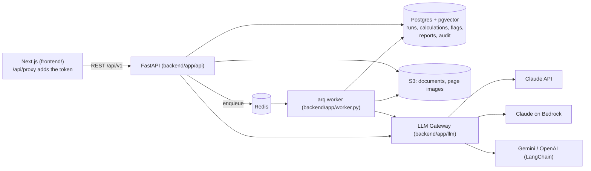
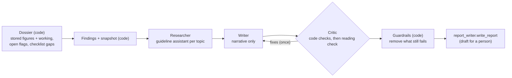

# Architecture (v1.0-rc, 25 Nov 2026)

A demo copilot for mortgage professionals. Two pillars: loan processing and underwriting (Pillar 1,
Daniel Reyes) and loss mitigation (Pillar 2, Angela Whitfield). All data is synthetic. The rules in
`CLAUDE.md` shape every part: code does the arithmetic, every finding links to evidence, people make
every decision, every setting is versioned and labelled, document text is data, corrections never
overwrite, and only `backend/app/llm` talks to a model provider.

## Runtime

| Layer | Where | Owner |
| --- | --- | --- |
| Screens | `frontend/` (Next.js 15, mock data or the real API through `/api/proxy`) | Amogh |
| API, services, database | `backend/app/api`, `services`, `db`, settings in `backend/config` | Abhay |
| Model calls, prompts, retrieval, agents | `backend/app/llm`, `prompts`, `rag`, `agents` | Arindam |
| Contract | `contracts/openapi.yaml` (every served path; a test keeps it so) | Arindam |

## Where AI is used, and where it is not

| Step | AI does | Code does (and checks) |
| --- | --- | --- |
| Classify a document (F1) | picks one type from the registry, cites lines | validates the type, falls back to review |
| Read a document (`extract@1`) | copies each field as printed, with line IDs | normalises amounts and dates, runs the arithmetic checks (`DI-CHK-*`), flags conflicts |
| Label transactions (F3) | one category per transaction | every total, deposit test and ratio |
| Read the hardship letter (F7) | profile with short quotes | verifies every quote against the letter's lines |
| Explain income flags (F2) | possible explanations, "possible — to be confirmed" | every figure must be one it was given |
| Guideline answer (F5) | short sentences citing retrieved passages | retrieval, threshold, and removal of any sentence whose citation, quote or figure fails |
| Underwriting copilot (F6) | Researcher questions, Writer narrative, Critic reading check | findings, snapshot, priorities, final guardrails |
| LM recommendation (F8) | the same three agents explain the result | every rule, the waterfall and the lender view |

Every model call goes through `app.llm.gateway.run(task, prompt_id, variables, output_model)`: the
provider and model per task come from `backend/config/llm.yaml`, the output is validated against a
strict schema (one retry with the validation error), and the log line holds IDs and token counts,
never document text. Each prompt tells the model that its inputs are data, and `clean_text` stops any
input from closing the tag it sits in (`tests/llm/test_prompt_injection.py`).

## The agents (Features 6 and 8)

The state is typed (`app/agents/workflow.py`, plain asyncio: three fixed steps and one loop). Each
agent's output is stored in `agent_runs`, so one agent can be re-run alone and writes the next report
version on the same run. A failed agent leaves its section "not available"; the report still
completes. For Pillar 2 the rules engine (`services/rules_engine.py`) has already decided every
condition and computed the lender view; the agents explain it and add Regulation X provisions with
the case's facts to check.

## Guideline retrieval (Feature 5)

Sources are Markdown files in `data/sources/` (one passage per section, ID `<source>.<section>`),
plus the seeded Sample Investor A passages. All are labelled illustrative. Retrieval is BM25 in
code with a coverage threshold and direct section lookup (`backend/config/rag.yaml`); Feature Design
5.7 names a local vector library, and embeddings can replace the scorer once an embedding provider
is configured (Claude has no embedding model). Questions, retrieved passages and scores, removed
sentences and feedback go to the audit log.

## Evidence and people

A finding, a figure or a condition carries its evidence (`document` with line IDs, `calculation`,
`rule`, `checklist`, `passage`). Corrections, overrides and condition decisions keep the original
beside the change, with who, when and why, and write an audit event. A sign-off records that a
person reviewed a report version; it is never a decision.

## Verified

- Golden tests: every worked example of the Feature Design to the cent (`backend/tests/golden`).
- Endpoint matrix: every endpoint against 401, 403, other-pillar 404 and 422 (`tests/db/test_endpoint_matrix.py`).
- Both demo stories through the HTTP API, upload to sign-off (`tests/db/test_demo_stories.py`).
- Provider evaluation, Claude API and Bedrock, 6/6 checks each (`docs/provider-evaluation.md`).
- Guideline evaluation: 16 questions, retrieval 14/14, no-support 2/2 (`python -m app.rag.evaluate`).

## Not built (Phase 2)

Multi-tenant row-level security, AWS deployment (ECS, SQS, Cognito), the publishers' real guide
text and embeddings, Feature 9 (case summary and letters), credit annotations
(`PATCH .../credit-analysis/latest/items/{item}`), an `llm_calls` table (the gateway logs only), and
a rules-only report so the recommendation can be signed off before the agents run.
